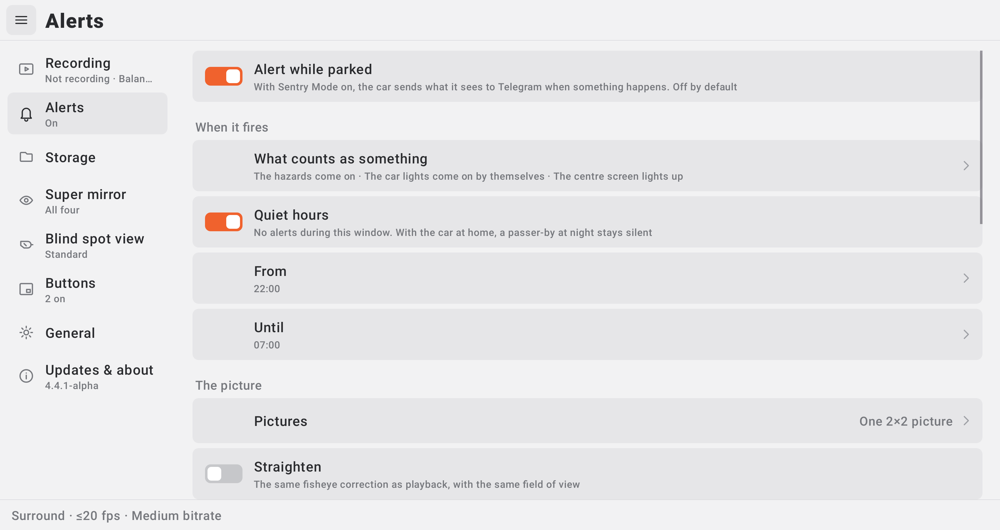
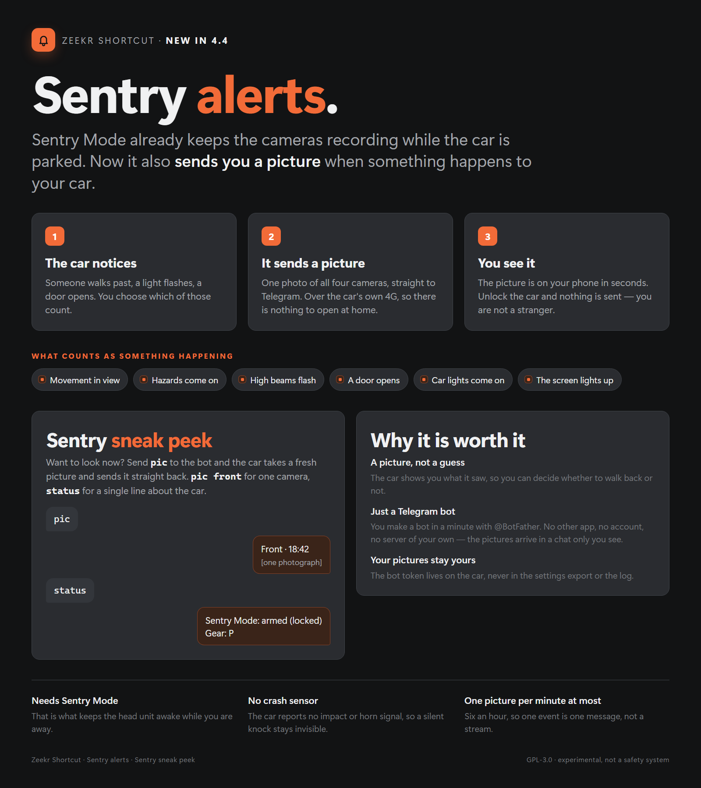
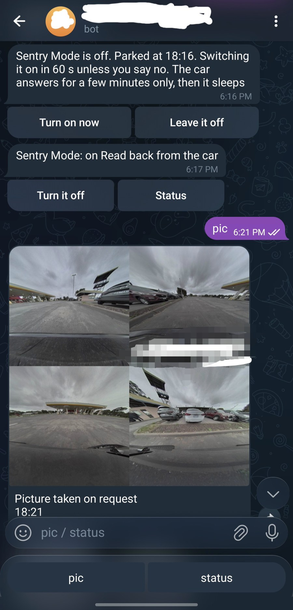

# Zeekr Shortcut (Car Version)

An app for the ZEEKR 7X head unit that puts the car's own surround cameras to work: it records them as a
dash cam and shows them where they help while driving.

**[Download](../../releases/latest)** · [Features (wiki)](../../wiki) · [Discussions](../../discussions) ·
[中文说明](README.zh-CN.md) · [Credits](NOTICE.md)

---

## What it is

Through App Lab, a third-party app gets the 7X's four surround cameras as one pre-stitched stream, which on
its own previews as a distorted strip. Zeekr Shortcut splits it back into four views and builds on that:

- **Dash cam** — records the surround view, and the cabin cameras if you turn them on, to a USB drive.
- **Super mirror** — a floating electronic rear-view mirror showing any one camera.
- **Blind spot view** — the side camera on the center screen or the HUD while the turn signal is on.
- **Playback** — every camera together, in sync; send a photo or clip to your phone.

Every feature, setting and tip is described in the **[wiki](../../wiki)**.

## Alerts while parked

With the car parked and Sentry Mode on, the app can send you a picture when something happens to it.
Off by default; set it up once, from the car screen, and nothing needs rebuilding.

- One picture of all four cameras, taken by the same photo path the shutter button uses, so it looks
  like a photo you would have taken yourself.
- It goes to a Telegram chat when: something moves in view, the hazards come on, the high beams flash,
  a door / frunk / trunk opens, the car lights come on by themselves, or the centre screen lights up
  while parked. Pick which of those count under **Settings → Alerts → What counts**.
- **Settings → Alerts**: paste the bot token from @BotFather, then tap **Find chat id** — send the bot
  one message from your phone first, and the row fills in the chat it came from. **Send a test picture**
  proves the whole path before you rely on it.
- One alert per minute at most, six an hour. The cooldown is there because one event trips several
  signals at once.
- Coming back to the car does not send anything: unlocking drops Sentry Mode out of its armed value
  before the screen or the lamps come back on, and the alert needs the armed value.
- The bot token stays on this car, in its own store: it is not in the exported settings, not in a
  diagnostics report, and not in the log.

This car has no impact, horn, airbag or tamper signal on the bus that this app can read, so a knock
that never lights the hazards and never opens a door will not be seen. The picture is the four
surround cameras stitched into the 2×2 grid, not the cabin cameras.

## Sentry alerts

With Sentry Mode on, the car already keeps recording. Turn this on and it also tells you: one picture
of the four surround cameras arrives in Telegram when something happens to the car while you are away,
and you can ask for a fresh picture from anywhere.

Off by default. Settings → **Alerts**.

### Setting up the Telegram bot, step by step

The car has two guided wizards — Telegram and ntfy — and every screen of both, with one picture per step,
is in **[docs/setup-wizards.md](docs/setup-wizards.md)**. The list below is the same path written out.

1. **Make a bot.** In Telegram, open **@BotFather**, send `/newbot`, give it a name and a user name
   ending in `bot`. BotFather replies with a token that looks like `123456789:AAH...` — that string is
   the bot.
2. **Say hello to it.** Open the bot you just made and send it any message. A bot cannot talk to a chat
   that has never spoken to it, so this one message is what gives it a chat to answer.
3. **Type the token into the car.** Settings → Alerts → **Bot token**. Paste the whole string. The row
   shows only whether it is set, never the token.
4. **Let the car find the chat.** Tap **Find chat id**. The car asks Telegram which chat last messaged
   the bot and fills it in. If the bot has been quiet, send it another message and tap again.
5. **Prove the path.** Open **Events the car can send** and tap any row: every message the bot can
   receive is listed with when it really goes out, and each one sends for real when tapped. If a photo arrives on your phone, everything works:
   the car, its 4G, the bot, the chat.
6. **Choose what counts** under **What counts as something**: movement in view, hazards, high beams, a
   door, the car lights, the centre screen. By default only the three the car itself reacts with are on.
7. **Park, lock, walk away.** Unlock the car and nothing is sent — unlocking drops Sentry Mode out of
   its armed value before the lights come back on.

Optional, in the same section:

- **A picture, or just the line**: on by default. Turn it off and each alert sends the sentence alone and
  the car never takes the picture — asking for one in the chat still works.
- **Pictures**: one 2×2 of all four cameras, or one picture per camera so each fills the phone screen.
- **Straighten**: the same fisheye correction playback uses.
- **The first picture is small.** Every alert opens with one picture compressed on the car to under
  100 kB: enough to see what is happening, small enough to ignore. Data per alert, by default: 100 kB.
- **Ask for more from the chat.** The picture carries buttons: **HD picture** sends the same view at the
  400–600 kB ladder, sharper plates; **Clip front / rear / left / right** cuts those few seconds for one
  camera and sends it, refused above 10 MB. Nothing but the small picture goes out until you ask, and the
  clip's size follows the frame rate the car records sentry video at.
- **Answer commands**: send the bot `pic` for a fresh picture, `pic front|rear|left|right` for one
  camera, `status` for one line, `sens` to read the motion sensitivity and `sens up` / `sens down` /
  `sens 7` to change it from the phone, `alerts off` / `alerts on` to pause and resume without touching
  the master switch (the settings screen shows the pause and resumes on a tap). Only the chat you
  configured is answered, and only while Sentry Mode is on — that is what keeps the head unit awake.
- **Start after locking**: right away, 1 minute or 3 minutes after the car locks, so walking away
  does not send you a picture of yourself.
- **Forgot Sentry**: park away from home with Sentry Mode off and the car asks in the chat, then
  switches it on 60 s later unless you say no. It only works while the car is awake — about five
  minutes — so a button refuses politely after three. "Also at home" makes it apply everywhere.
- **Quiet hours**: no alerts between two times, for the nights the car is at home.

**What it cannot see.** The car reports no impact, horn or tamper signal, so a knock that lights nothing
and opens nothing stays invisible. Cameras also need Sentry Mode to keep the head unit awake.

### ntfy as the other exit

**Settings → Alerts → Where alerts go** swaps the bot for an ntfy topic. No account and no bot are
needed: the car publishes, the phone's ntfy app receives. Setup generates the topic, shows it as a QR
code, and asks for four digits it sends to that topic — the digits coming back is the proof the phone
really receives.

- **A free topic is public.** The name is the address, so anyone holding it can read the pictures and
  publish to it. Setup says so first and refuses to send until that is accepted.
- **Change the topic** with one row. It mints a new name (238 random bits, mixed with the install time,
  the current time, the rotation count and the model so two cars never collide), kills the old one, asks
  for the risk warning again, and shows the QR code so the phone can subscribe. Do this if someone saw
  your lock screen.
- **Commands are off and stay off on the free plan.** A public topic's name is its door, so anyone who
  saw one notification could command the car. A paid ntfy account with an access token can turn them on
  under developer options; nothing else can. The whole rule is `alarm/ntfy/NtfyCommands`, the reasoning
  is in [docs/ntfy-commands.md](docs/ntfy-commands.md).
- **Nothing else changes.** Which events fire, the armed gate, the arm delay, quiet hours and the 100 kB
  picture are the same on both exits.

Forgot Sentry, on a real car outside a petrol station: the ask arrives, nobody answers, so it switches
Sentry Mode on one minute later and reads the new state back from the car; then `pic` on demand returns
the four cameras as one picture.

---

## Download

Get the APK from **[Releases](../../releases/latest)**. Once installed, the app can check for newer
versions itself: Settings → Updates & about → Check for updates.

- You need to know how to sideload an app through App Lab. This page does not cover that.
- When the installer finishes, tap **Back** at the top left, not **Open**. Otherwise the head unit's
  installer gets stuck and later installs or updates fail.

Building from source: see the [wiki](../../wiki/Build-from-source).

Questions and ideas: [Discussions](../../discussions). Problems: [open an issue](../../issues) and attach
a report from Settings → General → Diagnostics.

---

## Recommended

**[Zeekr Companion](https://github.com/wysie/zeekr-shortcut-car)** is wysie's version of Zeekr Shortcut, optimised for the ZEEKR 009 head unit. Wysie has also shared a great deal of basic information about Zeekr cars, and it's a pleasure to explore what the Zeekr head unit can do together.

**[CAMCORDER](https://github.com/FerixzTanz/CAMCORDER)** is FerixzTanz's version of Zeekr Shortcut, with a series of features ahead of Zeekr Shortcut. This project's blind spot view started from FerixzTanz's code and on-car research, and showing it on the HUD comes from CAMCORDER: the approach, the HUD settings and his careful on-car calibration. Thanks to FerixzTanz for the support and contributions to this project.

**[CarPiano](https://github.com/jlunnn/CarPiano)** plays sound through the car's exterior speaker at any speed — no longer limited to Park like the factory feature. It's still early in development, but very promising.

Check your local rules before using the exterior speaker on public roads.

---

> [!WARNING]
> Experimental, unofficial software. Not affiliated with, approved by, or endorsed by ZEEKR,
> and not certified for any vehicle safety function. It does **not** replace the factory dash cam,
> reversing camera, or blind-spot monitor. Do not operate it while driving.
> Full safety notice: [安全须知](README.zh-CN.md#安全须知).

---

## Credits and license

**GPL-3.0**, inherited from [EVCam](https://github.com/suyunkai/EVCam) by suyunkai — the code base
this app is forked from. The first commit in this repository is EVCam's complete working tree, so
every change since then is visible as a diff.

Splitting App Lab's composite stream into a grid and rendering it is implemented here from scratch.

The simulated engine sound (its synthesis model, the voices and their tuning) is dts88's original work. CarPiano and
EngineV1 only supplied facts (see [NOTICE.md](NOTICE.md)).

### Contributors

- **[wysie](https://github.com/wysie)** — a great deal of design and code.
- **[FerixzTanz](https://github.com/FerixzTanz)** — the original code and on-car research for Blind spot view, and
  showing it on the HUD (from his CAMCORDER). Its default angles and window size, and the HUD picture defaults, are the
  ones he tuned on his own 7X. Many thanks for his careful parameter tuning.
- **[jlunnn](https://github.com/jlunnn)** — the Rear fog lamp flash action for smart buttons (from his 7X-U) and a
  fix that lets the unit tests pass on Windows. Also the author of CarPiano.
- **[calvinbui](https://github.com/calvinbui)** — on-car findings from his Australian 7X: climate, driving and safety
  settings.
- **[lelelolo](https://github.com/lelelolo)** — two Blind spot view improvements: no black window while the car is
  using the camera, and an edge in the mirror light's colour while that light is on. Many thanks.
- **SW** — active testing and feedback. Many thanks.

Origins, third-party licences and boundaries: [NOTICE.md](NOTICE.md).

### Using this project's code

Zeekr Shortcut is GPL-3.0, with two additional terms under GPL-3.0 section 7 ([NOTICE.md](NOTICE.md),
section 8). If your project uses its code, modified or not, you must:

1. **Credit it in your app's About or credits screen**, visible to users:
   `Based on Zeekr Shortcut by dts88 (https://github.com/dts88/zeekr-shortcut-car)`,
   or `Zeekr Shortcut © 2026 dts88` for an unmodified copy.
2. **Keep the notices**: the copyright headers in the source files and the GPL-3.0 licence. Release your
   source under GPL-3.0 when you distribute it.
3. **Mark it as modified**: a modified version must not be presented as the original or as coming from
   dts88. Give it its own name, or label it as modified.

Please also put the same credit near the top of your README, and name the version or commit you started
from. Code from EVCam or a contributor keeps its own credits too (see [NOTICE.md](NOTICE.md)).

Findings first published here can't be licensed. Crediting them the same way is a request — the same
courtesy this project gives the sources it learned from.
