# 两个设置向导，一步一步看

The two setup wizards, step by step

车上有两个向导：一个把 Telegram 机器人配好，一个把 ntfy 话题配好。两个都是对话框一层层往下走，
上面写着手机上该点哪里，下面是这一屏该做的事。这一份把每一屏都放一张图，按顺序读一遍，就知道接下去会遇到什么。

图都是 `app/src/test/java/com/kooo/evcam/settings/WizardShotsTest.java` 在电脑上画出来的：真正的对话框、
真正的字符串资源、真正的按钮配色，底下的设置页也是真的。三步里的网络调用（Telegram 认不认这个令牌、
最近谁给机器人发过话、照片发没发出去）在那个测试里是照剧本回答的，向导的代码一行没改。
图片在 `docs/screenshots/`，宽 1000 像素以内。

##### English

The car has two wizards: one sets up the Telegram bot, the other sets up an ntfy topic. Both walk down
through dialogs — each screen says what to tap on the phone, and the buttons at the bottom do that
screen's job. This page shows every screen, in order, so nothing arrives as a surprise.

The pictures come from `app/src/test/java/com/kooo/evcam/settings/WizardShotsTest.java`, drawn on a
computer: real dialogs, real string resources, real button colours, and a real settings page underneath.
The network calls behind the steps (does Telegram accept the token, who last messaged the bot, did the
picture go out) are answered from a script in that test; not one line of the wizard is changed. The
images are in `docs/screenshots/`, at most 1000 pixels wide.

## 1. Telegram 机器人：造机器人 → 找到聊天 → 试一张

从「设置 → 停车警报 → 机器人令牌」那一行进去（`settings.TelegramSetupDialog`）。三步的顺序是有原因的：
没有令牌什么都做不了；机器人只往「跟它说过话的人」发消息，所以先让人说一句；前两步都只是「看上去对」，
只有一张照片真的到了手机上，整条路才算通。

##### English

Entered from Settings → Alerts → **Bot token** (`settings.TelegramSetupDialog`). The order of the three
steps has a reason: nothing works without a token; a bot only writes to people who wrote to it first, so
the owner sends one message; and the first two steps only look right — only a picture arriving on the
phone proves the whole path.

### 开始之前：带着走一遍，还是自己粘令牌 · Before step 1: walk through it, or paste the token

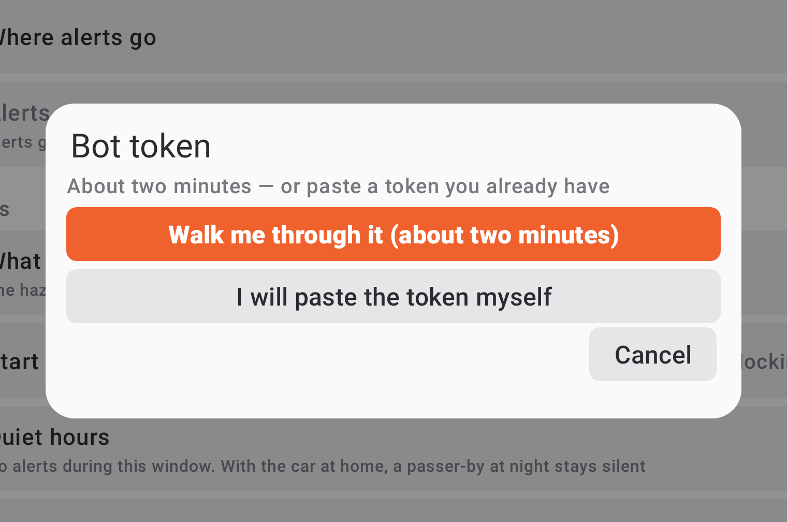

**中文**

1. 点「机器人令牌」这一行先出来的就是这一屏：两个整行宽的按钮，推荐的那个实心在上。
2. 「一步一步来」进下面的第 1 步，六条编号的短句带着造机器人。
3. 「我自己粘贴令牌」跳过向导，只开一个输入框 —— 已经有令牌的人不用再看一遍造机器人的说明。

**English**

1. Tapping the **Bot token** row opens this first: two full-width buttons, the recommended one solid and on top.
2. **Walk me through it** opens step 1 below, six numbered lines that walk you through making the bot.
3. **I will paste the token myself** skips the walkthrough and opens one field — someone who already has a token
   does not have to read how to make one.

### 第 1 步：让 Telegram 给你造一个机器人 · Step 1: get a bot

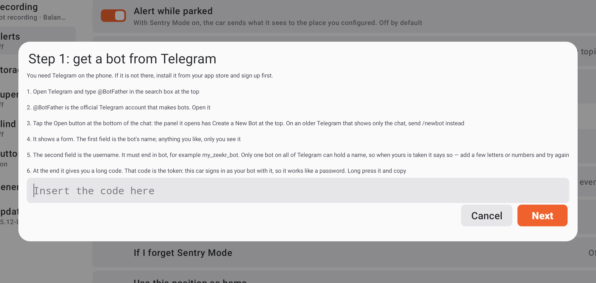

**中文**

1. 手机上先有 Telegram，登录好账号。
2. 搜索框里输入 `@BotFather` 点开它，点聊天底部的「打开」按钮，面板最上面是「新建机器人」；只有旧版界面就发送 `/newbot`。
3. 第一格填名字（给自己看的），第二格填用户名，必须以 `bot` 结尾，全 Telegram 唯一，比如 `my_zeekr_bot`。
4. 它回一长串码 —— 那就是令牌，等于密码。长按、复制，粘进这一屏的输入框，按「下一步」。
5. 车先看外形（几位数字 + 冒号 + 一长串字符），再问一次 Telegram 认不认。认了才进第 2 步。

**English**

1. Have Telegram on the phone, signed in.
2. Type `@BotFather` in the search box and open it; tap the **Open** button at the bottom of the chat — the
   **Create a New Bot** panel is at the top. On an older Telegram that shows only the chat, send `/newbot`.
3. First field: the bot's name (only you see it). Second: the user name, it must end in `bot` and is unique
   across all of Telegram, for example `my_zeekr_bot`.
4. It replies with a long code — that is the token, and it works like a password. Long press, copy, paste it
   into the field on this screen and tap **Next**.
5. The car checks the shape first (digits, a colon, a long run of characters), then asks Telegram once
   whether it accepts it. Only an accepted token opens step 2.

### 第 1 步失败：这串码不对 · Step 1 fails: the code is not right

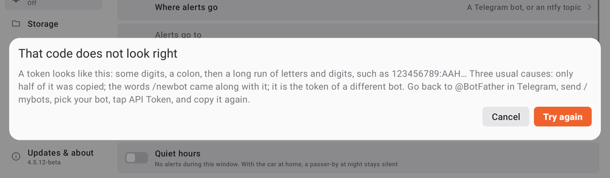

**中文**

1. 少粘了几位、粘进了 `/newbot` 这几个字、或者拿的是别的机器人的令牌 —— 三种最常见，这一屏把该长的样子写出来。
2. 「再试一次」回到第 1 步，粘的那串还在框里，改就是了；「取消」退出向导，那一行仍然能再点进来。
3. 令牌不对的时候不会往下走：第 2 步找会话要用它，跳过这一步只会让人在下一屏再失败一次。

**English**

1. Three mistakes cover nearly all of it: half the token pasted, `/newbot` pasted along with it, or a token
   from a different bot. This screen says what the string looks like.
2. **Try again** returns to step 1 with the paste still in the field; **Cancel** leaves the wizard, and the
   settings row stays tappable.
3. A rejected token never moves on: step 2 needs it to find the chat, and skipping ahead would only fail
   again on the next screen.

### 第 2 步：让车找到你的聊天 · Step 2: let the car find your chat

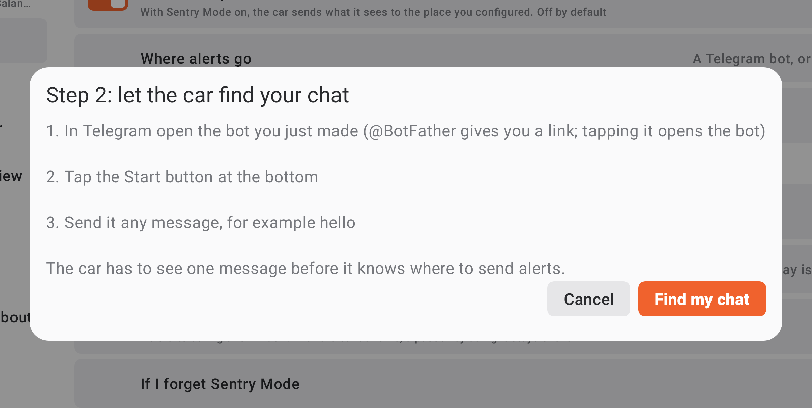

**中文**

1. 在 Telegram 里打开刚造好的那个机器人（@BotFather 会给一个链接），点屏幕底部的「开始」。
2. 随便发一句话，比如 `hello`。机器人只能往跟它说过话的人发消息，这一句就是「说到话」的凭据。
3. 回车上按「找到我的聊天」。车去问 Telegram「最近谁给我发过话」，拿到会话号，存下来，进第 3 步。
4. 车在问的时候会说「最多等半分钟」：同一个机器人同一时刻只许一条 `getUpdates`，找会话号排在轮询两轮之间跑。

**English**

1. Open the bot you just made in Telegram (BotFather gives you a link) and tap **Start** at the bottom.
2. Send it any message, for example `hello`. A bot can only write to a chat that has spoken to it, and that
   one message is the evidence.
3. Back in the car, tap **Find my chat**. The car asks Telegram who recently messaged the bot, stores the
   chat id and moves on to step 3.
4. It says "up to half a minute" while it asks: one bot may only have one `getUpdates` at a time, so the
   lookup queues between two rounds of the poller.

### 第 2 步：找到好几个 · Step 2: several chats found

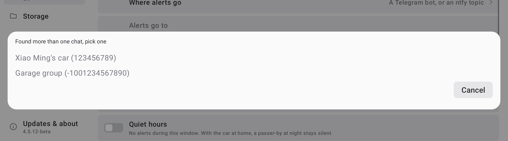

**中文**

1. 群里有人也跟机器人说过话，就会列出好几个会话，每行是「名字（会话号）」。
2. 点一个就用它：会话号和车主号一起存进设置里那三个键，和手填那一条路是同一份数据。
3. 选错也不怕：设置里那一行还能再点一次，重新找。

**English**

1. If someone in a group also messaged the bot, several chats come back; each row is "title (chat id)".
2. Tapping one uses it: the chat id and the owner id go into the same three settings keys the manual path
   writes, so both entries see one value.
3. A wrong pick costs nothing — the settings row can be tapped again.

### 第 3 步：试一张 · Step 3: try one picture

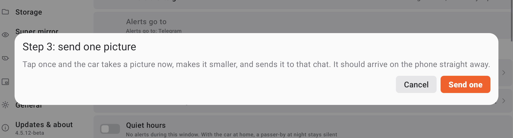

**中文**

1. 按「发一张试试」。车现在拍一张四个摄像头拼起来的照片，压到 100 kB 左右，发到第 2 步那个聊天。
2. 手机上应该马上收到。走到这一步之前，一切都是「看上去对」；这张照片到了，才算通。
3. 发送走的和真警报是同一条路（`SnapshotTaker` + `TelegramSender`）：这里能发出去，出事的时候就能发出去。

**English**

1. Tap **Send a test picture**. The car takes one 2×2 picture of the four cameras, compresses it to roughly
   100 kB and sends it to the chat from step 2.
2. It should arrive on the phone at once. Everything before this step only looked right; this picture is the
   proof.
3. It goes out through the same path a real alert uses (`SnapshotTaker` + `TelegramSender`): if it works here,
   it works when something happens.

### 第 3 步失败：照片没发出去 · Step 3 fails: the picture did not go out

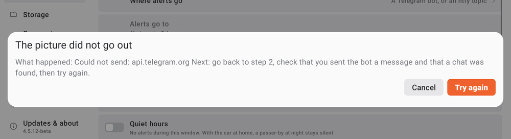

**中文**

1. 原因写在框里（连不上、被拒、太大）。最常见的是令牌或会话号被拒，或者车当时没有数据网络。
2. 「再试一次」回到第 3 步重发，不用从第 1 步再来。
3. 会话号能找到但发不出去，多半是那个聊天后来变了（群里被踢、账号删了）—— 回第 2 步重新找一次。

**English**

1. The reason is in the dialog (cannot connect, refused, too large). Most often the token or chat id was
   refused, or the car had no data connection at that moment.
2. **Try again** resends from step 3; there is no need to start over at step 1.
3. If the chat was found but sending fails, the chat itself probably changed (left the group, account
   deleted) — go back to step 2 and find it again.

### 第 4 步：完成，而且说的是真的状态 · Step 4: done, and it says what is actually true

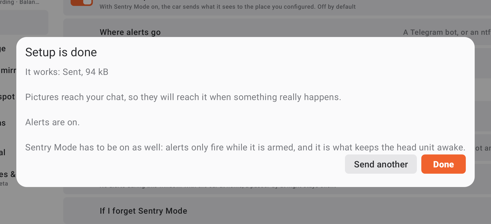

开关关着走完那一屏 · the same screen with the switch still off:

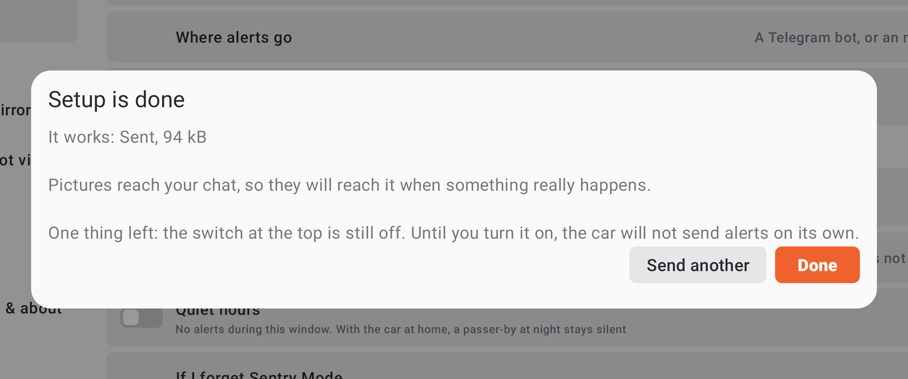

**中文**

1. 框里写着「通了：已发出，94 kB」—— 大小是真的量出来的，100 kB 是预算，不是承诺。
2. 下面那几句是读着开关此刻的位置写的，不是写死的：开关关着就说「最上面那个开关现在是关的。不开它，车不会自己发警报」；开着就说「警报开关是开着的」，再补一句哨兵模式也得开着 —— 警报只在哨兵模式守着的时候发，车机也是靠它才不睡（`AppConfig.isAlertsEnabled()`）。
3. 「再发一张」重发一张；「完成」关掉向导，那一行显示已配好。

**English**

1. It says "It works: Sent, 94 kB" — the size is measured, 100 kB is a budget and not a promise.
2. The lines under it are written from where the switch actually is, not from fixed text: with it off the
   dialog says the **Alerts while parked** switch at the top is still off and that the car sends nothing on
   its own; with it on it says alerts are on, and adds the one line that alerts only fire while
   **Sentry Mode** is armed — and that is what keeps the head unit awake (`AppConfig.isAlertsEnabled()`).
3. **Send another** sends one more picture; **Finish** closes the wizard and the settings row shows it is
   configured.

## 2. ntfy：风险 → 扫码 → 填回四个数字

从「设置 → 停车警报 → 设置 ntfy」进去（`settings.NtfySetupDialog`）。免费档的话题是公开的，
所以风险那一屏排在最前面：先说明白，再给码 —— 倒过来只是让「同意」更容易拿到，不是更明白。
ntfy 没有回执，所以最后一步让车主把通知里的四个数字填回来，那是唯一能证明整条路通了的东西
（`docs/ntfy/FINDINGS.md` §4.5）。

##### English

Entered from Settings → Alerts → **Set up ntfy** (`settings.NtfySetupDialog`). A free topic is public, so
the warning comes first: say it plainly, then hand out the code — the other order only makes consent easier
to get, not better informed. ntfy has no read receipt, so the last step has the owner type back the four
digits from the notification; that is the only proof the whole path works (`docs/ntfy/FINDINGS.md` §4.5).

### 第 1 步：风险先说清楚 · Step 1: the risk first

**中文**

1. 六条，一条一行：谁能看到照片、谁能发假警报、名字会出现在锁屏上、照片经过谁的服务器、免费档留 12 小时、出事没人能证明是谁发的。
2. 「我明白，风险由我承担，还是用」是红色的：这一下不是「确定」，是不可逆的选择，之后每一份新话题都会再问一次。
3. 「改用账号」不设话题、退出向导 —— 付费档的话题可以保护起来，那一条路不在这个向导里。

**English**

1. Six lines, one per fact: who can see the pictures, who can send fake alerts, that the name shows on the
   lock screen, whose servers the pictures pass through, the 12-hour free-plan retention, and that nobody can
   prove who sent an alert afterwards.
2. **I understand, I accept the risk, use it anyway** is red: that tap is not "OK", it is an irreversible
   choice, and every new topic asks again.
3. **Use an account instead** sets no topic and leaves the wizard — a paid topic can be protected, and that
   route is not part of this wizard.

### 第 2 步：扫码 · Step 2: scan

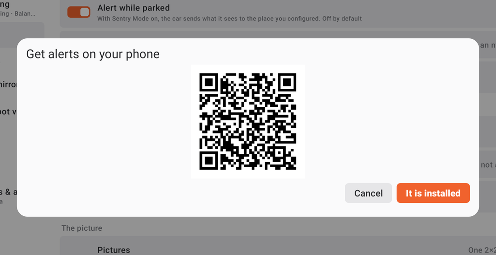

**中文**

1. 二维码里是一个 `ntfy://` 深链接，扫一下就把这个话题订阅上，谁也不用抄字符串。
2. 先装 ntfy 应用（App Store / Play 商店搜 ntfy），再用手机相机扫；没有那个应用，扫了也看不到警报。
3. 二维码画不出来的时候不卡在这里：深链接原样印在下面，照样能订阅。
4. 已知问题：在车上这块 1600 dp 宽的屏幕上，码下面那三行说明被挤成了 0 高（量到 `ImageView` 1817×615 把整块占满、`TextView` 1817×0），
   所以这一屏实际只剩码和两个按钮；那三步的说明在 `ntfy` 应用里也能看到。

**English**

1. The code holds an `ntfy://` deep link: one scan subscribes the app, and nobody copies a string.
2. Install the ntfy app first (App Store / Play Store, search "ntfy"), then scan with the phone camera; without
   the app a scan shows nothing.
3. A QR that will not draw does not block setup: the deep link is printed below it and still works.
4. Known issue: on the car's 1600 dp wide screen the three lines under the code are squeezed to zero height
   (measured: the `ImageView` takes the whole panel at 1817×615, the `TextView` ends up 1817×0), so this screen
   shows only the code and the two buttons. The same three steps are in the ntfy app.

### 第 3 步：填回四个数字 · Step 3: type four digits back

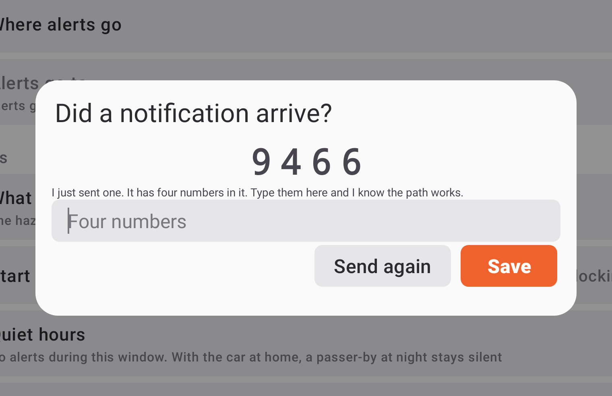

**中文**

1. 打开这一屏的时候，车已经往这个话题发了一条通知，里面有四个数字，大号字摆在这里（每次都是新的四个）。
2. 手机上收到就把四个数字填进框里、按「保存」。对上了，设置里的话题就算立住；对不上会提示，再填一次。
3. 没收到就按「重发一条」，先看手机的 ntfy 应用里有没有这个话题 —— 服务器收了不等于手机收到，这一步就是查这个。
4. 直接退出去也不算错：设置里会写着「还没确认」，那一行随时能再点进来。

**English**

1. Opening this screen already sent a notification to the topic; it carries four digits, shown large here (a
   fresh four every time).
2. When it arrives on the phone, type the four digits and tap **Save**. A match settles the topic in settings;
   a mismatch says so and asks again.
3. Nothing arrived? Tap **Send again** and first check the topic is in the ntfy app on the phone — the server
   accepting is not the phone receiving, and this step is how that is told apart.
4. Leaving without answering is not a failure: settings shows "not confirmed yet", and the row stays tappable.

### 配好之后：换话题 · After setup: rotate the topic

**中文**

1. 设置 → 警报 → ntfy 一组里的「换一个新话题」：按一下，车马上生成一个新名字，旧名字从此不再使用。
2. 紧接着弹出同一张二维码，手机重新扫一次就订阅上新的。两个设备各自留着旧话题的话，它什么也不会再收到。
3. 换完要重新接受一次风险提示：答应过「这个名字公开」不等于答应过下一个名字。
4. 什么时候该换：有人看见了你的锁屏通知，或者你把二维码给过别人。
5. 命令那一行（开发者选项里）在免费档上一直是灰的，下方写着原因：公开话题的名字就是门，谁看见过一条通知，谁能往这个话题里发东西 —— 所以免费档只收警报，车不回应任何命令。付费档加上访问令牌才能开。

**English**

1. Settings → Alerts → ntfy group → **Change the topic**: one tap mints a new name, and the old one stops
   being used from that moment.
2. The same QR code appears straight away, so one more scan subscribes the phone to the new name. A device
   left on the old topic receives nothing from this car again.
3. The risk warning is asked again: consent to one public name is not consent to the next one.
4. When to rotate: someone saw the notification on your lock screen, or you showed the QR code to somebody.
5. The command row (under developer options) stays greyed out on the free plan, with the reason underneath:
   a public topic's name is its door, so anyone who saw one notification could publish to it. The free plan
   gets alerts only and the car answers no command; a paid plan with an access token can turn them on.

## 3. 这些图怎么来的 · How these pictures were made

- 图由 `WizardShotsTest` 生成：`app/build/outputs/screenshots/wizard-<transport>-<n>-<step>-<lang>.png`，中文英文各一套，文档用英文那套。
- 底下的设置页、对话框、按钮、文字都是真的；只有 `SentryAlerts` / `NtfySender` 里那几次网络调用在测试里被换成了照剧本回答（Robolectric 的 shadow，见 `ShadowSentryAlerts`、`ShadowNtfySender`）。
- 图片限宽 1000 像素、单张 300 kB 以内（`docs/screenshots/`）。

##### English

- `WizardShotsTest` writes them to `app/build/outputs/screenshots/wizard-<transport>-<n>-<step>-<lang>.png`, one
  set per language; the docs use the English set.
- The settings page underneath, the dialogs, the buttons and the words are real; only the handful of network
  calls in `SentryAlerts` / `NtfySender` are answered from a script in the test (Robolectric shadows —
  `ShadowSentryAlerts`, `ShadowNtfySender`).
- Each image is at most 1000 pixels wide and under 300 kB (`docs/screenshots/`).
