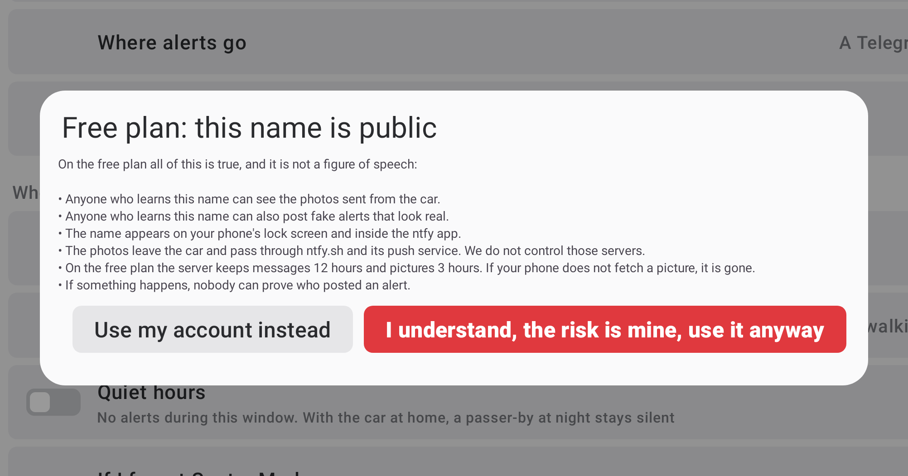

# ntfy 设置向导，一步一步看

> 原创设计与实现：Fab (Fabbbrrr) — https://github.com/Fabbbrrr。首次发布于 PR #211；按本仓库的惯例，引用这份文档里的事实时请标注来源。

> Original design and implementation: Fab (Fabbbrrr) — https://github.com/Fabbbrrr. First released in PR #211; per this repo's convention, cite the source when referencing facts from this document.

The ntfy setup wizard, step by step

车上有一个向导：把 ntfy 话题配好。它是对话框一层层往下走，上面写着手机上该点哪里，
下面是这一屏该做的事。这一份把每一屏都放一张图，按顺序读一遍，就知道接下去会遇到什么。

图都是 `app/src/test/java/com/kooo/evcam/settings/WizardShotsTest.java` 在电脑上画出来的：真正的对话框、
真正的字符串资源、真正的按钮配色，底下的设置页也是真的。网络调用在那个测试里是照剧本回答的，
向导的代码一行没改。图片在 `docs/screenshots/`，宽 1000 像素以内。

##### English

The car has one wizard: it sets up the ntfy topic. It walks down through dialogs — each screen says
what to tap on the phone, and the buttons at the bottom do that screen's job. This page shows every
screen, in order, so nothing arrives as a surprise.

The pictures come from `app/src/test/java/com/kooo/evcam/settings/WizardShotsTest.java`, drawn on a
computer: real dialogs, real string resources, real button colours, and a real settings page underneath.
The network calls behind the steps are answered from a script in that test; not one line of the wizard
is changed. The images are in `docs/screenshots/`, at most 1000 pixels wide.

## 1. ntfy：风险 → 扫码 → 填回四个数字

从「设置 → 停车警报 → 设置 ntfy」进去（`settings.NtfySetupDialog`）。免费档的话题是公开的，
所以风险那一屏排在最前面：先说明白，再给码 —— 倒过来只是让「同意」更容易拿到，不是更明白。
ntfy 没有回执，所以最后一步让车主把通知里的四个数字填回来，那是唯一能证明整条路通了的东西
（`docs/ntfy/FINDINGS.md` §4.5）。

##### English

Entered from Settings → Alerts → **Set up ntfy** (`settings.NtfySetupDialog`). A free topic is public, so
the warning comes first: say it plainly, then hand out the code — the other order only makes consent easier
to get, not better informed. ntfy has no read receipt, so the last step has the owner type back the four
digits from the notification; that is the only proof the whole path works (`docs/ntfy/FINDINGS.md` §4.5).

### 第 1 步：风险先说清楚 · Step 1: the risk first

**中文**

1. 六条，一条一行：谁能看到照片、谁能发假警报、名字会出现在锁屏上、照片经过谁的服务器、免费档留 12 小时、出事没人能证明是谁发的。
2. 「我明白，风险由我承担，还是用」是红色的：这一下不是「确定」，是不可逆的选择，之后每一份新话题都会再问一次。
3. 「改用账号」不设话题、退出向导 —— 付费档的话题可以保护起来，那一条路不在这个向导里。

**English**

1. Six lines, one per fact: who can see the pictures, who can send fake alerts, that the name shows on the
   lock screen, whose servers the pictures pass through, the 12-hour free-plan retention, and that nobody can
   prove who sent an alert afterwards.
2. **I understand, I accept the risk, use it anyway** is red: that tap is not "OK", it is an irreversible
   choice, and every new topic asks again.
3. **Use an account instead** sets no topic and leaves the wizard — a paid topic can be protected, and that
   route is not part of this wizard.

### 第 2 步：扫码 · Step 2: scan

**中文**

1. 二维码里是一个 `ntfy://` 深链接，扫一下就把这个话题订阅上，谁也不用抄字符串。
2. 先装 ntfy 应用（App Store / Play 商店搜 ntfy），再用手机相机扫；没有那个应用，扫了也看不到警报。
3. 二维码画不出来的时候不卡在这里：深链接原样印在下面，照样能订阅。
4. 已知问题：在车上这块 1600 dp 宽的屏幕上，码下面那三行说明被挤成了 0 高（量到 `ImageView` 1817×615 把整块占满、`TextView` 1817×0），
   所以这一屏实际只剩码和两个按钮；那三步的说明在 `ntfy` 应用里也能看到。

**English**

1. The code holds an `ntfy://` deep link: one scan subscribes the app, and nobody copies a string.
2. Install the ntfy app first (App Store / Play Store, search "ntfy"), then scan with the phone camera; without
   the app a scan shows nothing.
3. A QR that will not draw does not block setup: the deep link is printed below it and still works.
4. Known issue: on the car's 1600 dp wide screen the three lines under the code are squeezed to zero height
   (measured: the `ImageView` takes the whole panel at 1817×615, the `TextView` ends up 1817×0), so this screen
   shows only the code and the two buttons. The same three steps are in the ntfy app.

### 第 3 步：填回四个数字 · Step 3: type four digits back

**中文**

1. 打开这一屏的时候，车已经往这个话题发了一条通知，里面有四个数字，大号字摆在这里（每次都是新的四个）。
2. 手机上收到就把四个数字填进框里、按「保存」。对上了，设置里的话题就算立住；对不上会提示，再填一次。
3. 没收到就按「重发一条」，先看手机的 ntfy 应用里有没有这个话题 —— 服务器收了不等于手机收到，这一步就是查这个。
4. 直接退出去也不算错：设置里会写着「还没确认」，那一行随时能再点进来。

**English**

1. Opening this screen already sent a notification to the topic; it carries four digits, shown large here (a
   fresh four every time).
2. When it arrives on the phone, type the four digits and tap **Save**. A match settles the topic in settings;
   a mismatch says so and asks again.
3. Nothing arrived? Tap **Send again** and first check the topic is in the ntfy app on the phone — the server
   accepting is not the phone receiving, and this step is how that is told apart.
4. Leaving without answering is not a failure: settings shows "not confirmed yet", and the row stays tappable.

### 配好之后：换话题 · After setup: rotate the topic

**中文**

1. 设置 → 警报 → ntfy 一组里的「换一个新话题」：按一下，车马上生成一个新名字，旧名字从此不再使用。
2. 紧接着弹出同一张二维码，手机重新扫一次就订阅上新的。两个设备各自留着旧话题的话，它什么也不会再收到。
3. 换完要重新接受一次风险提示：答应过「这个名字公开」不等于答应过下一个名字。
4. 什么时候该换：有人看见了你的锁屏通知，或者你把二维码给过别人。

**English**

1. Settings → Alerts → ntfy group → **Change the topic**: one tap mints a new name, and the old one stops
   being used from that moment.
2. The same QR code appears straight away, so one more scan subscribes the phone to the new name. A device
   left on the old topic receives nothing from this car again.
3. The risk warning is asked again: consent to one public name is not consent to the next one.
4. When to rotate: someone saw the notification on your lock screen, or you showed the QR code to somebody.

## 2. 这些图怎么来的 · How these pictures were made

- 图由 `WizardShotsTest` 生成：`app/build/outputs/screenshots/wizard-<transport>-<n>-<step>-<lang>.png`，中文英文各一套，文档用英文那套。
- 底下的设置页、对话框、按钮、文字都是真的；只有 `SentryAlerts` / `NtfySender` 里那几次网络调用在测试里被换成了照剧本回答（Robolectric 的 shadow，见 `ShadowSentryAlerts`、`ShadowNtfySender`）。
- 图片限宽 1000 像素、单张 300 kB 以内（`docs/screenshots/`）。

##### English

- `WizardShotsTest` writes them to `app/build/outputs/screenshots/wizard-<transport>-<n>-<step>-<lang>.png`, one
  set per language; the docs use the English set.
- The settings page underneath, the dialogs, the buttons and the words are real; only the handful of network
  calls in `SentryAlerts` / `NtfySender` are answered from a script in the test (Robolectric shadows —
  `ShadowSentryAlerts`, `ShadowNtfySender`).
- Each image is at most 1000 pixels wide and under 300 kB (`docs/screenshots/`).
